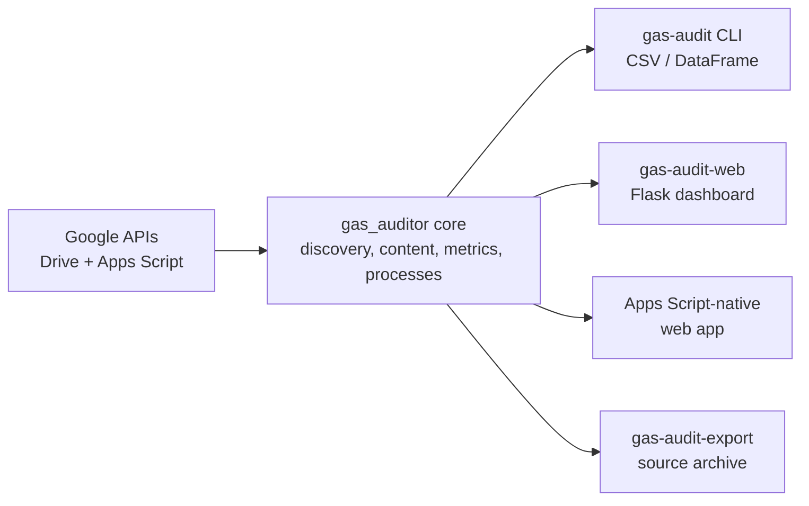
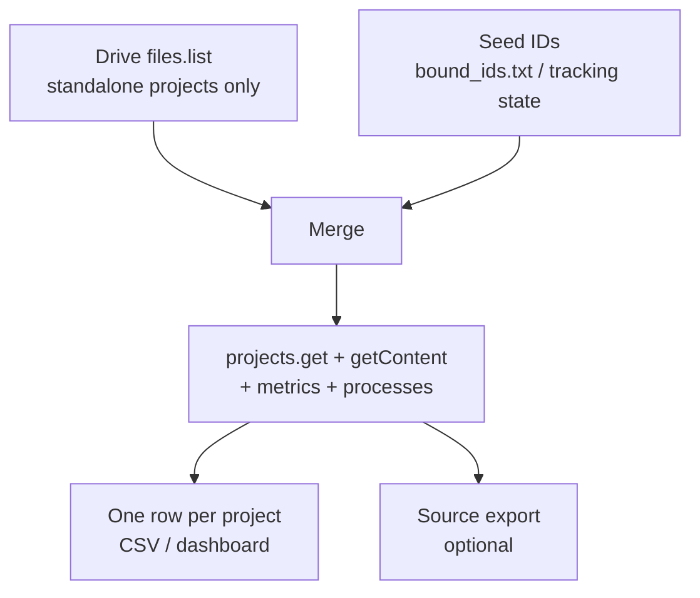

# gas-auditor — Google Apps Script Auditor

[](https://github.com/enonymous1/gas-auditor/actions/workflows/ci.yml)
[](LICENSE)
[](pyproject.toml)

**Google hides some of your scripts from Drive. This finds them anyway.**

gas-auditor inventories every Google Apps Script project you own and audits
each one — files by type, functions, OAuth scopes, advanced services,
metrics (active users, executions, failures), and recent executions by
type and status. It is for anyone whose Apps Script estate has grown past
what they can remember: scripts bound to Sheets and Docs, old add-ons,
one-off automations, and the projects you forgot you wrote.

One command produces one row per project in `gas_audit.csv` (or a Polars
DataFrame in code). Read-only throughout: the four scopes it requests are
the minimum needed, and it never modifies a project.

<!-- Demo visual: record the dashboard (or a CLI run) against a throwaway
account with toy projects — never your real account, project names would
be on display — save it as docs/demo.gif, then uncomment this block:

For a theme-aware still instead, save docs/dashboard-light.png and
docs/dashboard-dark.png and use the <picture> block below it. -->

## Why this exists

Google gives you a project list at script.google.com, but no inventory:
no scopes, no execution health, no answer to "what is this script allowed
to do, and is it still running?" Scripts accumulate silently — created
from inside a document, deployed once as a web app, then forgotten.

Worse, part of the estate is *unlistable by design*. Container-bound
scripts (created from inside a Sheet, Doc, Slides, or Form) do not appear
in Google Drive at all, and no API can enumerate them — see
[Discovery](#discovery-standalone-vs-container-bound-projects) below.
gas-auditor closes that gap with a seed-and-remember mechanism: hand it a
bound project's ID once, and it is audited on every run from then on.

## Non-goals

- **It never modifies anything.** Read-only scopes; there is no write,
  deploy, or delete path.
- **It is not clasp.** No push/pull or local-edit workflow — for source
  archiving, use the read-only exporter below.
- **It cannot list triggers.** The Apps Script API exposes executions, not
  configured triggers; execution history is the closest available signal.
- **It is not multi-user hosting.** A local tool for your own account, or
  the Apps Script-native version running as its viewer.

## Quick start

Prerequisite first, because the install alone won't run: a one-time
Google Cloud setup (~5 minutes) — enable the Drive and Apps Script APIs,
create a Desktop OAuth client with exactly the four read-only scopes,
and save it as `credentials.json`. Full steps are in the Google Cloud
setup section below (collapsed, so the quick start stays quick).

```bash
pip install -e .          # installs the package + the `gas-audit` command
gas-audit                 # -> gas_audit.csv in the current directory
```

Without installing:

```bash
pip install -r requirements.txt
PYTHONPATH=src python -m gas_auditor
```

The first run opens a browser for consent and writes `token.json`.
Later runs reuse/refresh it silently; delete `token.json` if you change
scopes. `credentials.json` is **you create this** (gitignored, never
commit); `token.json` is created on first run (also gitignored).

```bash
gas-audit-web               # Flask dashboard: http://127.0.0.1:5001
gas-audit-export            # bulk source archive (see below)
```

## What you get

One row per project (sample values — the shape, not real data):

| Project | Files | Scopes | Executions (7d) | Failed | Status |
|---|---|---|---|---|---|
| Example Sheet Helper | 4 | 2 | 128 | 0 | ok |
| Example Standalone Tool | 9 | 5 | 1,204 | 3 | 1 stage error |
| Example Bound Script | 3 | 1 | 0 | 0 | ok |

In the CSV, list columns (`oauth_scopes`, `function_names`,
`advanced_services`) are flattened to `; `-joined text; in the Polars
DataFrame they stay as lists, and `file_counts_by_type` /
`process_types` / `process_statuses` stay as structs. A project that
fails one stage (permissions, quota, deleted) lands in that stage's
`*_error` column instead of aborting the run.

## How it works



Discovery merges two sources, because neither alone is complete:



## Choose your surface

| Surface | When to use it |
|---|---|
| `gas-audit` (CLI) | Scheduled inventories, CSV pipelines, library use |
| `gas-audit-web` (Flask dashboard) | Browsing, project detail pages, clickable scope definitions |
| `apps-script/` (Apps Script-native) | No local install, runs as the viewer, Workspace-org demo |
| `gas-audit-export` | A local source archive of everything, bound projects included |

<details>
<summary><b>Google Cloud setup (~5 minutes)</b></summary>

1. Go to https://console.cloud.google.com/ and create (or select) a project.
   This does **not** have to be any Apps Script project's own Cloud project —
   one auditor project works for everything you own.
2. **APIs & Services → Library** — enable both:
   - **Google Drive API**
   - **Google Apps Script API**
3. **APIs & Services → OAuth consent screen**
   - User type: **External** (or **Internal** if this is a Workspace org account
     and you only need it inside the org).
   - App name / support email / developer email: anything sensible.
   - Scopes (add exactly these four):
     - `https://www.googleapis.com/auth/drive.metadata.readonly`
     - `https://www.googleapis.com/auth/script.projects.readonly`
     - `https://www.googleapis.com/auth/script.metrics`
     - `https://www.googleapis.com/auth/script.processes`
   - If the app stays in **Testing** status (External): add your own Google
     account under **Test users**, otherwise Google blocks the consent.
     Note: Testing-mode refresh tokens expire after 7 days — if the auditor
     starts re-prompting weekly, click **Publish app** on the consent screen.
4. **APIs & Services → Credentials → Create Credentials → OAuth client ID**
   - Application type: **Desktop app**
   - Download the JSON, rename it to `credentials.json`, put it in the
     directory you run the auditor from.

</details>

<details>
<summary><b>CLI reference</b></summary>

```bash
gas-audit --output audit.csv --metrics-granularity DAILY
gas-audit --process-limit 100 --process-since-days 90
gas-audit --all-drives        # include shared drives
gas-audit --verbose
```

Cross-run tracking (first/last seen + missing detection): every run
updates `gas_audit_state.json` (override with `--state PATH`, disable
with `--no-state`), a small JSON file keyed by scriptId recording
`first_seen`, `last_seen`, `times_seen`, and `status`
(`active`/`missing` + `missing_since`). The CSV gains `first_seen` /
`last_seen` columns, and the run log summarises what changed — new
projects, returned projects, renames (scriptId is stable across them),
and newly-missing ones (deleted, unshared, or moved out of scope — the
state can't tell you which, only that discovery stopped returning it).
One guard: if the discovery scope changed since the last run
(`--all-drives` flipped), missing-marking is skipped for that run so
shared-drive projects aren't mass-flagged. The dashboard shares the same
state file and rules (`gas-audit-web --state/--no-state`). The Apps
Script-native version has no equivalent yet — it's deliberately
stateless, so tracking there would need a Drive-backed state decision.

Rate limits: the Apps Script API enforces per-minute per-user quotas and
an audit bursts 4 calls per project, so every API call is wrapped in
exponential-backoff retries (429/5xx, `Retry-After` honoured — see
`retry.py`). A scan may pause briefly mid-run while a quota window rolls
over; that's the retry working, not a hang. (Found live, 2026-10-21: a
13-project run without retries lost 4 stages to 429s. The Apps Script
version's `apiGet_` has the same retry.)

</details>

<details>
<summary><b>Exporting project source code (<code>gas-audit-export</code>)</b></summary>

The auditor inspects code; the exporter *keeps* it — a local source
archive of your projects, bound ones included (it fetches by scriptId):

```powershell
gas-audit-export                          # everything: Drive discovery + state seeds
gas-audit-export --script-id <ID>         # one specific project
gas-audit-export --from-csv gas_audit.csv # everything in an audit CSV
gas-audit-export --from-state gas_audit_state.json
gas-audit-export --output-dir ./gas-archive
```

Selectors union and de-duplicate; with none given it discovers (seeded
from the tracking state, so known bound projects come along). Layout:
`<output-dir>/<title-slug>__<scriptId[:8]>/` containing the project's
files with clasp-style extensions (`SERVER_JS` → `.js`, `HTML` → `.html`,
manifest as `appsscript.json`) plus a `project.json` metadata snapshot
(title, parent/container, timestamps, editor URL, file inventory).
Re-running syncs files down in place; files deleted upstream are
reported as stale and **kept**, never removed. Exit code is 1 if any
project failed (each failure is isolated and logged).

⚠️ Exported source is verbatim — Apps Script projects often embed API
keys in code. The default `gapps-projects/` dir is gitignored here;
treat any export root the same way.

</details>

<details>
<summary><b>Web dashboard (Flask + Jinja2 + HTMX)</b></summary>

An additional surface over the same core — the CLI, CSV export, and library
API above are unchanged, and nothing in the core imports Flask.
Display logic lives in `web/viewmodels.py` (pure functions); templates in
`web/templates/` stay declarative; routes are a thin Flask factory in
`web/app.py` — the same app-factory pattern as a typical Flask viewer.

```bash
pip install -e ".[web]"     # adds Flask
gas-audit-web               # http://127.0.0.1:5001  (local only by default)
# or: python -m gas_auditor.web --port 5001 --metrics-granularity DAILY
```

Flow: **Scan Workspace** → `GET /api/scan` starts the audit on a background
thread (a scan is N projects × 4 API calls and can take minutes — it does
not block the request) and returns a Jinja fragment that polls
`GET /api/scan/status` every 2s; when the job finishes, the status route
returns the results table (Project Name, Last Modified, File Count, Scopes
Requested, Recent Execution Status) and polling stops. The results fragment
also links **Download CSV** → `GET /api/export.csv`, which serves the last
completed scan as `gas_audit.csv` (409 until a scan has completed).

**Project detail (modal + page):** each row's project name links to a
full detail page at `/project/<scriptId>`, and its **Details** button
opens the same content in a modal (`GET /api/project/<scriptId>`) —
grouped sections for overview, code/manifest, permissions, usage
metrics, recent executions, stage errors, and the GitHub association,
with outbound links to Drive and the script editor.

**Theming:** the dashboard is theme-aware — it follows your OS
light/dark setting by default (`prefers-color-scheme`), and the
**◐ Theme** toggle (top right) forces a mode and remembers it in the
browser (`localStorage`). All colours are CSS variables in `base.html`.

**Result caching:** the last completed scan is rendered server-side on
page load, so going into a project page and coming back lands on the
results — no re-scan. The Scan button always starts a fresh scan, and if
you return mid-scan the page rejoins the in-flight polling.

**Clickable scopes:** every OAuth scope in the table and the detail view
is a chip that opens a definition modal: plain-language summary,
Google's sensitivity classification (Non-sensitive / Sensitive /
Restricted) where established, and a link into the matching section of
Google's official OAuth scope reference. Definitions are curated in
`web/scopes.py` (~35 common scopes); unknown scopes say so honestly and
still link to the reference index.

**GitHub in the dashboard:** start it with the CLI's opt-in flags —
`gas-audit-web --github-candidates <json|checkout-dir>
[--github-mapping <json>]` — and scans are enriched identically. For a
project with a linked repo, the detail view shows the match tier and
evidence, and renders the repo's **README.md**: from the candidate's
local checkout when candidates came from a directory scan, otherwise
fetched from `raw.githubusercontent.com` (the repo's default branch if
known, else main, then master; public repos only, no token support yet).
READMEs render from Markdown (`.[web]` also pulls in `Markdown`) with
script tags and inline handlers stripped, lazy-load into the detail
view, and are cached for the session.

Notes:

- Binds `127.0.0.1` by default and uses Flask's built-in development
  server, which is the right weight for a local single-user tool. There is
  **no auth** in the dashboard itself — anyone who can reach it can trigger
  a scan and read the inventory, so think before using `--host` to expose it.
- HTMX is loaded from a CDN in `base.html`, so the page needs internet
  access to be interactive. Vendor the file locally if you need offline use.
- History: v0.3.0 shipped this dashboard in FastHTML; v0.4.0 swapped the
  presentation layer to Flask/Jinja (owner's call — the stack he knows).
  `web/service.py` (background scan) and the whole core were untouched by
  the swap, which is the point of the layering. Two FastHTML warts went
  away with it: no `.sesskey` file in the working directory, and
  `/api/export.csv` works as named (FastHTML's static route 404'd
  extension-suffixed paths, forcing `/api/export`).

</details>

<details>
<summary><b>Apps Script-native dashboard (alternative front-end)</b></summary>

`apps-script/` contains the same audit implemented as a Google Apps Script
project, deployable as a web app that runs **as the viewing user** — no
stored credentials, no server, results held in the browser with a
client-side CSV download. Built for personal use now, Workspace-org demo
later; public distribution is a separate bridge (OAuth verification).
See `apps-script/README.md` for the file map and deploy steps.

</details>

<details>
<summary><b>GitHub association matching (spike, Python only, opt-in)</b></summary>

There is no registry linking a GAS project to a GitHub repo, so this is
**evidence-tiered matching**, never a boolean lookup. It is fully offline
in this spike — no GitHub API calls — and off unless you pass a flag, so
the default audit is unchanged.

```bash
# candidates from a local directory of repo checkouts (scans each repo for
# .clasp.json, appsscript.json, function definitions, .git origin):
gas-audit --github-candidates ~/code/checkouts

# …or from a JSON inventory export (e.g. produced by ss-github-repos):
gas-audit --github-candidates repos.json

# curated overrides always win ({"<scriptId>": "owner/repo", ...}):
gas-audit --github-candidates repos.json --github-mapping mapping.json
```

Each row gains four columns:

| Column | Meaning |
|---|---|
| `github_repo` / `github_repo_url` | best candidate, empty if none |
| `github_match` | `confirmed` / `probable` / `possible` / `none`; empty = matching never ran (distinct from `none` = searched, no evidence) |
| `github_evidence` | the signals behind the tier |

Tiers: **confirmed** = curated mapping, the scriptId found in a repo's
`.clasp.json`, or the repo referenced in the project's own Drive
description (fetched during discovery for exactly this). **probable** =
exact non-generic name match + corroboration (appsscript.json, or ≥2
shared non-generic function names), or a strong function fingerprint.
**possible** = a single weaker signal (name alone, etc.). Generic titles
(`Test`, `Untitled`, …) and generic functions (`onOpen`, `doGet`, …)
never count as evidence.

Candidate JSON is flexible about key spellings (`full_name`/`fullName`,
`html_url`/`url`, `clasp_script_id(s)`, `files`, `functions`); see
`github_link.py`'s docstring. Precision on real data is the open question
this spike exists to answer — review `possible`/`probable` rows before
trusting them, and promote true ones into the mapping file.

Known gap: the Apps Script-native version does **not** have these fields
yet (its row shape stays at the original 41 fields) — parity is a
deliberate follow-up once the tiers prove themselves on real data.

</details>

<details>
<summary><b>Use as a library (Polars)</b></summary>

```python
from pathlib import Path
import polars as pl
from gas_auditor import (audit_project, build_services, discover_projects,
                         get_credentials, to_dataframe)

creds = get_credentials(Path("credentials.json"), Path("token.json"))
drive, script = build_services(creds)
rows = [audit_project(f, script, metrics_granularity="WEEKLY",
                      process_limit=50, process_since_days=None)
        for f in discover_projects(drive)]
df = to_dataframe(rows)
print(df.filter(pl.col("failed_executions") > 0))
```

In the DataFrame, `oauth_scopes` / `function_names` / `advanced_services`
stay as list columns and `file_counts_by_type` / `process_types` /
`process_statuses` stay as structs; in the CSV they are flattened to
`; `-joined text.

</details>

<details>
<summary><b>Layout (modular package, no monolith)</b></summary>

```
gas-auditor/
├── pyproject.toml            # installable package, `gas-audit` console script
├── requirements.txt          # same dependencies, for a plain pip install
├── src/gas_auditor/
│   ├── __init__.py           # public API re-exports
│   ├── __main__.py           # python -m gas_auditor
│   ├── config.py             # SCOPES, Drive constants, AUDIT_FIELDS (no logic)
│   ├── auth.py               # OAuth 2.0 flow + Drive/Script client construction
│   ├── discovery.py          # Drive API v3: find all script projects
│   ├── project.py            # Apps Script projects.get (bound parent, timestamps)
│   ├── content.py            # projects.getContent: file stats + manifest parsing
│   ├── metrics.py            # projects.getMetrics
│   ├── processes.py          # processes.listScriptProcesses (recent executions)
│   ├── audit.py              # per-project orchestration, per-stage error isolation
│   ├── output.py             # CSV export + Polars DataFrame
│   ├── cli.py                # argparse entry point
│   ├── errors.py             # shared one-line error formatting
│   ├── retry.py              # 429/5xx exponential-backoff wrapper for API calls
│   ├── tracking.py           # cross-run state: first/last seen, missing detection
│   ├── github_link.py        # offline GitHub-association matcher (spike)
│   └── web/                  # OPTIONAL Flask dashboard (extra: .[web])
│       ├── viewmodels.py     # pure display logic for the templates (no I/O)
│       ├── templates/        # Jinja2: base.html, index.html, project.html, fragments/
│       ├── service.py        # background scan job (thread + state)
│       ├── readme.py         # GitHub README resolver/renderer for the detail view
│       ├── scopes.py         # curated OAuth scope definitions + Google docs links
│       └── app.py            # create_app() Flask factory, routes, entry point
└── tests/                    # stdlib unittest, fixture payloads = real API shapes
    ├── fixtures.py           # fake Drive/Script services + sample payloads
    ├── test_content.py
    ├── test_metrics_processes.py
    ├── test_audit_output.py
    ├── web_fixtures.py
    ├── test_web_viewmodels.py  # skipped without the web extra
    ├── test_web_service.py
    ├── test_web_readme.py
    ├── test_retry.py
    ├── test_tracking.py
    ├── test_web_scopes.py
    └── test_web_app.py
├── apps-script/              # Apps Script-native version (see its README)
│   ├── appsscript.json, Config.gs, Api.gs, Audit.gs, Scan.gs, WebApp.gs
│   └── Index.html, Stylesheet.html, JavaScript.html
└── tests-gas/                # Node tests for the .gs implementation
    └── test_audit.js
```

</details>

## Discovery: standalone vs container-bound projects

Drive `files.list` finds **standalone** projects only. Google's docs say it
plainly: container-bound scripts (created from inside a Sheet / Doc /
Slides / Form) *"do not appear in Google Drive"* — they are ghosted from
Drive listing, the container file carries no reference back to its script,
and no API (Drive, Apps Script, or executions) can enumerate them. If your
Apps Script dashboard shows more projects than the auditor finds, this is
why: the missing ones are bound.

The bridge is the one direction Google left open — a bound project **is**
fetchable when its scriptId is known:

1. Open each bound project once (from its container's *Extensions → Apps
   Script*, or from script.google.com) and copy the ID from the editor URL:
   `script.google.com/home/projects/`**`<ID>`**`/edit`.
2. Put the IDs in a text file, one per line, and pass it once:
   `gas-audit --script-ids-file bound_ids.txt`
   (or repeat `--script-id <ID>`; the dashboard takes the same flags).
3. That's the only manual step, ever: the run's tracking state remembers
   every seeded ID, and both the CLI and dashboard feed all state-known
   IDs back into discovery on every later run. Seeded projects get the
   full audit (their `parent_id` will show the container), and if one is
   later deleted, tracking reports it as newly missing as usual.

**Generating the starter file** (so you're editing, not typing from
scratch): `gas-audit --script-ids-out bound_ids.txt` writes every known
project ID — annotated with names and `[bound to …]` markers — after a
run; the Flask dashboard offers the same file as a download on its home
page (and via `--script-ids-out` after each scan). IDs in your input
file that didn't resolve are preserved in the output, so the
generate → edit → re-run loop never loses entries.

**Apps Script dashboard parity:** the native dashboard has the same
support — a *Container-bound projects* panel with a seed-ID textarea
(remembered in your browser's localStorage only) merged into every scan,
plus a *Download script IDs (.txt)* button producing this exact file
format, interchangeable with the Python side.

*Alternative, not built:* each bound script could self-register its ID into
its container's developer metadata (an "inside-out" snippet run inside
every bound project), making binds enumerable via the container files.
More moving parts inside production scripts; the seed file achieves the
same inventory with zero code inside them.

## Tests

Offline, no Google account needed (fixtures mirror the real API payloads):

```bash
PYTHONPATH=src:tests python -m unittest discover -s tests -v
```

## Known limits

- **No trigger listing exists in the API.** `TIME_DRIVEN` / `TRIGGER` counts
  in `process_types` mean such executions happened — they are not a list of
  configured triggers.
- `active_users_latest` is the most recent metrics interval only (unique
  users can't be summed across intervals without double-counting).
  `total_executions` / `failed_executions` *are* summed across intervals.
- Projects you can view but whose owner hasn't enabled API access, deleted
  projects, etc. land in the row's `*_error` columns instead of aborting the run.
